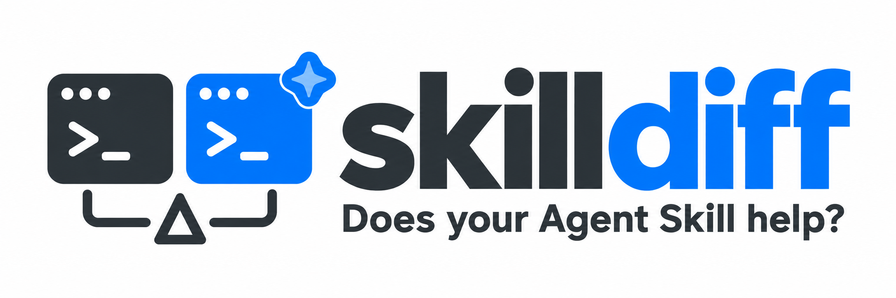
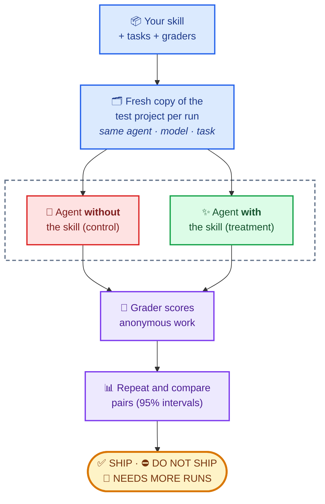

# SkillDiff



Tell your coding agent which skill to evaluate. SkillDiff runs matched tasks with
and without the skill and measures what changes. Your agent prepares the tests,
runs the evaluation, and explains whether the evidence supports keeping the skill.

You can run SkillDiff through Claude Code, Codex, Antigravity CLI (AGY),
or OpenCode V2. You provide the goal and skill path, and the installed SkillDiff skill
gives your agent instructions for setup, evaluation, and reporting.

## Set up once through your agent

Paste this into your coding agent:

```text
Set up SkillDiff for this agent from https://github.com/karangattu/skilldiff.
Read the repository's skills/skilldiff/SKILL.md and follow its setup instructions.
Install the command and SkillDiff skill for this agent only.
```

Your agent handles installation and uses your normal CLI login. If it needs a login
or shell permission, it tells you the exact step. You need Python 3.12+, Git, and a
signed-in agent CLI. See [manual setup](#manual-setup) if you prefer to install it yourself.

## Ask your agent

Once setup is complete, give your agent a short request. Replace the example paths
with your skill folders. The agent uses the current CLI and an available model,
and asks only when it cannot establish a necessary choice.

### Try the demo

You do not need your own skill or test files:

```text
Use skilldiff to try its changelog demo and explain the result.
```

### Test your skill

Point to the folder that contains your SKILL.md:

```text
Use skilldiff to test ~/code/my-project/skills/my-skill. Start with a small trial and explain the result.
```

### Compare two skill versions

Point to the original and updated skill folders:

```text
Use skilldiff to compare ~/skills/v1/my-skill with ~/skills/v2/my-skill.
Start with a small trial and tell me whether there is enough evidence to choose a version.
```

The agent prepares the test files and automatic checks, then runs one small
comparison. You do not need to write YAML, choose flags, or run commands yourself.
Tests use your agent account or API credits. The agent asks before a larger
paid evaluation unless you already authorized it.

## What you get

Your agent explains the score, skill use, cost, time, and tokens. It links the
report and gives SkillDiff's decision: `SHIP`, `DO NOT SHIP`, or
`NEEDS MORE RUNS`, with the evidence and uncertainty. A first trial checks setup;
it does not establish a shipping decision. Missing measurements stay `N/A`.
Low adoption blocks a `SHIP` result. Adoption is judged on the runs used by the closing
decision (the held-out runs when configured, or all runs otherwise). The report,
saved results, and `skilldiff diagnose` all evaluate this same set of runs.

Reports include per-arm hit rates, load counts, and concrete next steps for
improving a skill's description, plus JSON for agent analysis, Markdown for
summaries, and HTML for optional viewing. Claude subscription runs default to
API-equivalent cost from a built-in rate table; pin a full model ID such as
`claude-sonnet-5-5` or `claude-haiku-5-5` so the price and the served model stay
the ones you chose. Bare family names such as `sonnet` fail config loading. See
[reports and outputs](docs/reference.md#reports-and-outputs) for the full format.

The prompt never names the skill by default, so adoption measures discovery:
whether the description makes the agent reach for the skill on its own. Set
`skill_invocation: explicit` to name the skill in the prompt and measure
obedience instead. Running the same experiment both ways shows what the
description contributes. See
[explicit versus implicit skill use](docs/reference.md#explicit-versus-implicit-skill-use).

## Agent instructions

Start with [skills/skilldiff/SKILL.md](skills/skilldiff/SKILL.md).
The [agent workflow](skills/skilldiff/references/agent-workflow.md) covers setup,
harness selection, small trials, and the existing JSON commands for reading results.
Use the saved report's decision when explaining the outcome.

## Agent support

SkillDiff checks the CLI version, required commands, and structured formats inside
the selected execution environment before paid work. Each treatment skill is
installed once in the native workspace directory. Follow-up `prompts:` share one
conversation, workspace, and deadline; arms and repetitions have separate sessions.

Empty output, malformed streams, explicit failures, and missing completion events
are harness errors even when the CLI exits zero. SkillDiff keeps partial telemetry,
but excludes these sessions from paired decisions. Unknown usage and cost stay `N/A`.
Claude subscription authentication remains the default; SkillDiff does not use
`--bare`. See [the compatibility contract and verification limits](docs/compatibility.md).

OpenCode v2.0.23 uses session export fallback when the final completion event is omitted.
See [verified releases and limits](docs/compatibility.md#verification) before running.

## Manual setup

<details>
<summary>Installation commands and updates</summary>

You need Python 3.12+, Git, and a signed-in agent CLI (`claude`, `codex`, `opencode`, or `agy`).

**1. Install the `skilldiff` tool:**

```bash
uv tool install git+https://github.com/karangattu/skilldiff
```

> [!NOTE]
> A git install is pinned to the commit resolved at install time, so an existing
> `skilldiff` will not pick up later fixes on its own. Run `uv tool upgrade skilldiff`
> to refresh it.

> [!IMPORTANT]
> Install from GitHub as shown above. The `skilldiff` package on PyPI is a different project.

**2. Install the skill into your agent** (replace `claude-code` with `codex`, `opencode`, or `antigravity-cli`):

```bash
npx skills add karangattu/skilldiff -g -y --copy -a claude-code
```

To upgrade installed skills to the latest version:

```bash
npx skills update skilldiff -g
```

| Agent | `-a` value | Installs to |
|---|---|---|
| Claude Code | `claude-code` | `~/.claude/skills/skilldiff` |
| Codex | `codex` | `~/.agents/skills/skilldiff` |
| OpenCode | `opencode` | `~/.config/opencode/skills/skilldiff` |
| Antigravity CLI (AGY) | `antigravity-cli` | `~/.gemini/antigravity-cli/skills/skilldiff` |

Use `--copy` so AGY receives the skill in its native global directory.
The installer treats Antigravity CLI and the desktop agent as separate agents.
For AGY, reinstall with `npx skills add karangattu/skilldiff -g -y --copy -a antigravity-cli`
after an update if the native copy is missing.

Always pass `-a`. Without it, the [`skills` CLI](https://github.com/vercel-labs/skills)
may install into every agent it knows, which is about sixty folders. `-g` installs
for your user, so every project can use the skill. Without `npx`, copy the
[`skills/skilldiff`](skills/skilldiff) folder into the folder shown in the table.
Claude Code users can instead install the plugin, which adds a
`/skilldiff:skilldiff <path>` command:

```bash
# Inside Claude Code
/plugin marketplace add karangattu/skilldiff
/plugin install skilldiff@skilldiff
```

You install only the skilldiff skill. SkillDiff copies the skill *under test* into
each run's workspace itself.

</details>

<details>
<summary>If your agent cannot start SkillDiff</summary>

**One-time setup if your agent sandboxes its shell.** Your agent runs `skilldiff`,
and `skilldiff` starts its own agent sessions. Those sessions need network access
and write access to their login folder. Allow `skilldiff` once:

| Your agent | One-time setup |
|---|---|
| Claude Code | In `.claude/settings.json`: `{"permissions": {"allow": ["Bash(skilldiff *)"]}, "sandbox": {"excludedCommands": ["skilldiff *"]}}` |
| Codex | Add `prefix_rule(pattern=["skilldiff"], decision="allow")` to `~/.codex/rules/default.rules`, or approve the command when Codex asks |
| OpenCode | If shell access is restricted, add `{"permissions": [{"action": "shell", "resource": "skilldiff *", "effect": "allow"}]}` to `opencode.json` (V2) |
| Antigravity | Approve `skilldiff` when asked, or add `command(skilldiff)` and `unsandboxed(skilldiff)` to `permissions.allow` in `~/.gemini/antigravity-cli/settings.json` |

If you skip this setup, `skilldiff check` fails with a `host:` line and prints the
fix for your agent. `skilldiff run` halts before starting any sessions.
Because a full evaluation can exceed the agent's shell timeout, the skill tells your
agent to run it in the background.

</details>

<details>
<summary>Manual CLI workflow and commands</summary>

```bash
skilldiff init --skill ~/code/my-pkg/skills/my-skill --harness claude --dir my-skill-eval
cd my-skill-eval
# 1. Put a small test project in fixtures/
# 2. Describe a real task in tasks/ (do not name the skill in the prompt)
# 3. Write a grader in graders/ that scores the result
skilldiff check          # validates config, CLI login, permissions, and graders
skilldiff run --split dev --runs 1   # smoke test: one pair per dev task
skilldiff results        # show the latest run
```

After reviewing the small test, freeze your held-out tasks and use `skilldiff run`
for a new full evaluation. Held-out tasks are saved tests that you keep unchanged
while improving the skill.

[`examples/csv-totals`](examples/csv-totals) is a complete small experiment you can
copy. It has a skill, dev and held-out tasks, fixtures, a grader, and a sample report.
[`examples/py-shiny-troubleshooting`](examples/py-shiny-troubleshooting) is a
larger 6-task benchmark pack for Python Shiny diagnostic skills, with known-good
and known-broken solutions per task.

| Command | What it does |
|---|---|
| `skilldiff init` | Create an experiment (`--skill`, `--skill-a/--skill-b`, or `--pr`) |
| `skilldiff check` | Check config, CLI login, permissions, skill exposure, and graders |
| `skilldiff run` | Run the experiment (`--runs N`, `-t TASK`, `--resume`) |
| `skilldiff results` / `report` | Show or rebuild the reports for a run |
| `skilldiff diagnose` | Explain failures: skill not triggering, regressions, denied tools |
| `skilldiff regrade` | Re-grade a finished run after a grader fix, without new sessions |
| `skilldiff compare` | Compare two runs |
| `skilldiff lint` | Lint a `SKILL.md` before you spend anything; `--prompts PATH` checks trigger coverage |

</details>

<details>
<summary>How the comparison works</summary>



- Both arms use the same agent, model, task, and starting files. Only the skill differs.
- Each run gets its own throwaway workspace. Control receives no installed target
  copy; confirmed discovery or loading invalidates the baseline.
- Graders see `candidate-A` and `candidate-B`, never which arm is which.
- Arm order alternates from a recorded seed. Inputs are frozen and hashed, so results are reproducible.

</details>

<details>
<summary>Evaluation details and permissions</summary>

Agent sessions started by skilldiff run headless, so prompts cannot be answered
interactively. Any tool that prompts for permission is refused, and the agent continues
without it. The default settings avoid prompts and give both arms matching permissions:

| Harness | Default | To allow network |
|---|---|---|
| `claude` | `sandbox: true`: Bash runs in Claude's own sandbox without prompts; writes stay in the workspace | `allowed_domains: ["pypi.org"]` |
| `claude` + `profile: eval` | sandbox stays on; commands inside it are auto-approved and localhost binding is allowed | add app hosts to `allowed_domains` |
| `codex` | `sandbox: workspace-write`, no prompts | `network_access: true` |
| `opencode` | `dangerously_skip_permissions: true` (passes `--auto`) | already allowed |
| `antigravity` | `dangerously_skip_permissions: true` | already allowed |

`claude.profile: eval` is opt-in for app evaluations. It never allows unsandboxed
commands, so graders and skill sources stay unreadable. `skilldiff check` prints
what sessions may do and runs a profile-aware sandbox canary; any refused or
skipped command shape fails the check. For local Claude runs it also runs each
task's `runtime_probe` through Claude's Bash tool. Reports and `skilldiff
diagnose` count denied tool calls per arm for all four harnesses (including
Codex sandbox blocks), so a broken permission setup cannot pass as a low score.
To block reads outside the workspace as well, use `isolation: docker`/`podman`,
or `isolation: macos` for Claude and Codex.

Native macOS setup handles uv Python aliases, shell heredocs, Git configuration,
and temporary pytest collection without opening host skill or grader contents.
Use a task `runtime_probe:` that runs the actual test workflow before model calls;
failed probes show both output streams. Codex records filesystem errors from
failed commands even when its overall session succeeds. See the
[runtime setup guide](skills/skilldiff/references/preflight.md) for a probe example.

Temporary workspace repositories disable automatic Git maintenance so their
files stay stable while repeated attempts copy the prepared template.

Set `parallel: 1` and `arm_parallel: false` for serial runs. Explicit concurrency
settings are honored; omitted settings can use automatic parallelism.

## Tips for useful results

- Write tasks that need what only the skill knows, such as obscure APIs, recent changes, or house rules. If control already scores 100%, the task is too easy.
- Include tasks where the skill should stay out of the way (`category: irrelevant`).
- Tune on `tasks/dev/`, then freeze `tasks/heldout/`. When held-out tasks are planned, the decision requires held-out pairs, even if none have run yet.
- Start with 5 or more runs per arm, and fix that number before you look at results.
- Give each grader a known-good and a broken solution (`validation:`), so `check` can prove the grader works.

</details>

## More detail

The [reference](docs/reference.md) has the exact rules:

- [Reports and outputs](docs/reference.md#reports-and-outputs) and [the example result](docs/reference.md#example-result)
- [Experiment files](docs/reference.md#experiment-files) and [tasks, graders, and categories](docs/reference.md#tasks-graders-and-categories)
- [Why SkillDiff, and how it stays fair](docs/reference.md#why-skilldiff)
- [Where skilldiff installs the skill under test](docs/reference.md#where-skilldiff-installs-the-skill-under-test)
- [Thresholds and verdicts](docs/reference.md#thresholds-and-verdicts)
- [Presets, revisions, and PR tests](docs/reference.md#presets-revisions-and-pr-tests)
- [Resume compatibility and recovery](docs/reference.md#resume-compatibility-and-recovery)
- [Harness setup and commands](docs/reference.md#harness-setup-and-commands)
- [Preflight safeguards](skills/skilldiff/references/preflight.md) and [reporting rules](skills/skilldiff/references/reporting.md)

<details>
<summary>Development</summary>

```bash
git clone https://github.com/karangattu/skilldiff && cd skilldiff
uv sync --frozen --extra dev
uv run --frozen --extra dev python -m pytest
uv run --frozen --extra dev ruff check .
```

These commands select the project environment without relying on shell activation.
Lint the whole repository, including benchmark packs, to match CI and release checks.

See [CHANGELOG.md](CHANGELOG.md) for version history. Current version is 0.27.0.

</details>
