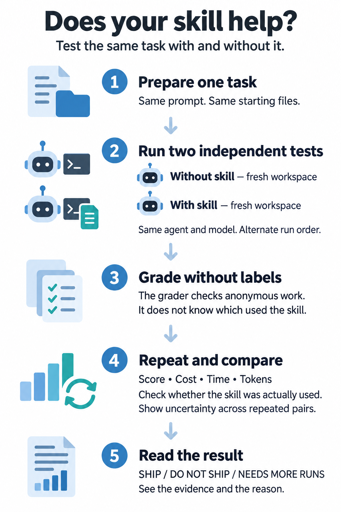

# SkillDiff reference

For agent-led setup, execution, and structured output commands, see the
[agent workflow](../skills/skilldiff/references/agent-workflow.md). The installed
skill contains the evaluation instructions; the user can provide a goal and path.

Detailed reference for [SkillDiff](../README.md). Start with the README; come back
here for exact rules, config keys, and edge cases.

## Reports and outputs

Each run writes four files:

- `report.html`: full report with tables and takeaways.
- `report.md`: short version for pull requests.
- `report.qmd`: version for Quarto.
- `results.json`: raw data for scripts.

Each run also saves the transcript and the diff for each agent run.

`results.json` is the raw data for scripts. It includes `skill_usage` (per-arm
adoption), `adoption_failed`, `adoption_failed_arms`, `adoption_unmeasured_arms`,
and `adoption_basis`, and each task's prompt text in `task_details`, so the
report can quote the wording that missed the trigger. Prompts are stored
verbatim; keep run directories out of shared artifacts if a prompt holds
sensitive text.

The terminal output and saved reports include an **Evaluation results** table with
App, Arm, Score, Time, Input, Cached input, Output, Total tokens, Tool calls,
Turns, Skill loaded, and API-equivalent cost. App is the task ID; each app and arm
has a row per model, plus a paired Δ row when both arms are present. Scores are
means; resource usage and costs are totals across eligible matched repetitions.
Cached input includes cache reads and writes. Missing measurements or pricing
show as `N/A`.

Reports end with a **Closing decision** table — score, cost, time, tokens, tool
calls, turns, and adoption, each with paired change, 95% CI, and a plain reading — preceded by
**Skill adoption and next steps**, which reports hits, eligible and unknown runs,
hit rate, and load events per skill arm plus concrete description and scope
actions for missed or over-triggered tasks. Then comes one bottom line: SHIP, DO
NOT SHIP, or NEEDS MORE RUNS, with the reason. A hit is an eligible run where the
skill loaded at least once; failed and unknown runs never count as misses.

Adoption is judged on the **decision basis**: the held-out runs when the
experiment declares a held-out split, every run otherwise. The report states the
basis it used, and `results.json` and `skilldiff diagnose` judge the same runs, so
one number answers "can this result ship?" everywhere. A skill arm blocks a SHIP
when it loaded the skill in fewer than two-thirds of its measured runs, or when
it never loaded the skill in any measured run. A hit rate needs three measured
runs before it can judge an arm; fewer measured runs is thin evidence, reported
as such. An arm whose adoption could not be measured — the harness saw a skill
call but no result for it — also blocks a SHIP. An arm the harness never reported
adoption for is a gap in the evidence, not a failure, and does not block a
decision. The config can record `pricing:` rates (per 1M tokens, with source and date), but
Claude models use a built-in rate table keyed by full model ID. Reports
reproduce an **API-equivalent cost** table from the saved token breakdown. On
subscription auth, `cost_basis: api-equivalent` is the default; API-key runs keep
the harness cost unless `api-equivalent` is set explicitly. Old results without a
recorded basis keep their original interpretation. Missing usage or model rates
remain `N/A`, and the original harness cost stays in `run.json`.

Haiku 5.5 is priced by prompt size (up to and over 100K tokens). Exact tiering
uses per-request usage recorded from Claude's stream. A tiered run without that
usage is `N/A` for the decision by default; `tier_policy: upper_bound` adds a
labelled planning estimate that the SHIP/DO NOT SHIP calculation ignores.

A **Skill context tax** table estimates the frozen skill's text footprint and
the overhead if that text is carried on every turn. File size and estimated
tokens are separate from measured harness token use; this table does not measure
actual prompt injection or spend.

The terminal and saved reports use the same shipping decision, including control
validity, held-out evidence, and the number of tasks with usable paired scores.
Planned tasks with grader failures do not satisfy the task-coverage safeguard.

A complete small evaluation lives in [`examples/csv-totals`](../examples/csv-totals):
a skill, dev and held-out tasks, fixtures, a deterministic grader, and a
committed sample report. Copy it as a starting point. The reusable
[`examples/py-shiny-troubleshooting`](../examples/py-shiny-troubleshooting)
pack adds a 6-task static-troubleshooting set.

## Example result

The numbers below are examples. They are not real results.

| **App** | **Arm** | **Score** | **Time** | **Input** | **Cached input** | **Output** | **Total tokens** | **Tool calls** | **Turns** | **Skill loaded** | **API-equivalent cost** |
| ------- | ------- | --------- | -------- | --------- | ---------------- | ---------- | ---------------- | -------------- | --------- | ---------------- | ----------------------- |
| csv-totals | Control | 60% | 450s | 100,000 | 500,000 | 70,000 | 670,000 | 30 | 15 | 0/5 | $1.50 |
| csv-totals | Skill | 80% | 375s | 80,000 | 400,000 | 56,000 | 536,000 | 25 | 10 | 5/5 | $1.20 |
| csv-totals | Δ (Skill - Control) | +20 pp | -75s | -20,000 | -100,000 | -14,000 | -134,000 | -5 | -5 | | -$0.30 |

How to read the table:

- Δ is skill minus control as a paired-mean change.
- Control and Skill show means for score and medians for cost and time.
- Reading states the verdict for that row in plain words. It uses the same Δ and interval, so the three columns never disagree.
- If the interval includes zero, the result can be noise.
- `N/A` means the value is unknown, not zero.
- `n=X/Y` shows how many pairs gave a value.
- Cost is the harness-reported price. On subscription auth the real spend is $0 at the margin, so Claude subscription runs default to API-equivalent cost. Full model IDs use the built-in table; add `pricing:` rates only to override them or to price another provider. Regenerating the report prices the saved token breakdown again.
- If Codex omits `cache_write_input_tokens`, skilldiff calculates totals and API-equivalent cost from reported input, cache-read, and output counts; any unreported cache-write usage is excluded.

### Tips for clear results

- Use 5 or more runs as a starting point, not a rule. Fix the budget before you look at results.
- Cover four kinds: intended tasks, normal representative tasks, irrelevant tasks, and ambiguous plus regression tasks.
- Split `tasks/dev/` (iterate) from `tasks/heldout/` (freeze before the full run). The report keeps them separate in By split and decides on held-out only.
- Write tasks that need what only the skill gives. Good tasks use obscure APIs, recent changes, or house rules.
- Do not name the skill in prompts. Adoption is part of the test. (To measure what happens when you *do* name it, see [Explicit versus implicit skill use](#explicit-versus-implicit-skill-use).)
- If control scores 100%, the task is too easy. The report calls this a ceiling effect.
- Read warnings about agent errors, grader errors, and skill runs that ignored the skill.
- Many repetitions of two tasks still describe only those two tasks. Add tasks before you generalize.

<a id="explicit-versus-implicit-skill-use"></a>

## Explicit versus implicit skill use

By default the task prompt never names the skill. The agent has to notice the
skill on its own, so the adoption rate measures **discovery**: whether the
SKILL.md description triggers on the task wording.

Set `skill_invocation: explicit` to name the skill in the prompt instead:

```yaml
skill_invocation: explicit          # implicit (default) | explicit
skill_invocation_prompt: "Use the {skill} skill for this task."   # optional
```

The default instruction is "Use the `shiny-doctor` skill for this task." for one
skill, and "Use the skills `a`, `b` for this task." for a skill pack. A custom
`skill_invocation_prompt` replaces it; `{skill}` becomes the arm's skill name(s).
Only arms that actually carry the skill get the instruction, so a control arm
without the skill is never told to use one.

In explicit mode the adoption rate measures **obedience**: whether the agent uses
a skill it was told to use. The report says so, names the arm "Skill (named)",
and stops blaming the description. Run the same experiment both ways to see the
discovery gap: the difference between the two adoption rates is what the
description is worth.

A task file can override the experiment setting, which lets you test one
wording on one task:

```yaml
skill_invocation: explicit          # in a task file
```

Rules the config enforces:

- PR runs reject `explicit`; they compare revisions, not skill use.
- A/B runs reject `explicit` when the two revisions have different skill names,
  because the arms would get different instructions. Give both revisions the same
  name, or set `skill_invocation_prompt` to an instruction that does not name the
  skill ("Use the available skill for this task.").

`skilldiff compare RUN_A RUN_B` prints the invocation mode of each run and warns
when the modes differ, because the adoption difference then mixes obedience with
discovery.

## Experiment files

**What each folder holds:** `skilldiff.yaml` holds name, skill path, harness, models, tasks, run count, seed, thresholds, failure policy, skill invocation mode, and optional `pricing:` overrides for API-equivalent costs (Claude full model IDs already have built-in rates). `tasks/` holds one YAML file per task with an id, a prompt (or `prompts:` for a multi-turn script), a category, an optional `split: dev|held-out`, an optional `skill_invocation:` override, optional path assertions (`allowed_paths`, `forbidden_paths`), and optional `validation: {good, broken}`. `fixtures/` holds the small test projects, copied fresh for each run without `.git` history and with escaping symlinks rejected. `graders/` holds the scripts that score the work.

Every key listed there is checked when the config loads: an unknown or misspelled key (in the experiment file, a nested block such as `claude:` or `thresholds:`, a task file, or a `grader:`) fails `skilldiff check` and `skilldiff run` immediately, naming the closest matching key, instead of being ignored while the run uses defaults you never chose.

Values are checked too: path patterns, `prompts:`, and arguments must be lists of
strings; flags must be YAML booleans; run and parallel counts must be positive
integers; explicit `parallel: 1` is honored, and `arm_parallel: false` separately
disables simultaneous arms. Omitted settings may use automatic parallelism.
Prices, thresholds, and timeouts must be finite numbers. Unsupported
isolation modes fail rather than falling back to host execution. Distinct task
files must have unique IDs; overlapping globs can safely select the same file.

Older block names (`agy:` and `on_failure:`) are checked even when their replacements are also present. Optional sections accept `null` or `{}`; lists, booleans, numbers, and strings are rejected instead of being treated as empty settings.

<a id="why-skilldiff"></a>

## Why SkillDiff, and how it stays fair

You can compare a skill by hand: ask an agent to do a task once with the skill
and once without, then read both results. That is fine for a quick sanity check.
It falls apart as a measurement, because the parts that make the comparison
trustworthy are bookkeeping that is easy to skip and hard to notice you skipped.

| By hand | SkillDiff |
|---|---|
| Runs both arms in your working repo | A fresh copy of the fixture per arm, with no `.git` history; escaping symlinks are rejected |
| Lets the agent see which run is which, and sometimes grade its own work | Graders see `candidate-A` and `candidate-B`, with names and arm labels removed |
| Runs one arm, then the other | Seeded, balanced order, so neither arm keeps the warm cache every time |
| Compares two numbers by eye | Paired differences with a bootstrap 95% confidence interval |
| Edits the skill while testing | Each run freezes skills, tasks, fixtures, and graders under a sha256 manifest |
| Judges whether the output looked good | Also records adoption, cost, time, and tokens for both arms |

<p align="center">
  
</p>

What keeps it fair:

- **Isolation.** SkillDiff marks detected control-arm skill loading or workspace contamination INVALID. For Claude the default excludes user settings from automatic loading. Local agents may still read skill sources or saved snapshots elsewhere on the host; exposure warnings are advisory and do not prove contamination. Use container execution or an enforced read sandbox to block those paths.
- **Blind grading.** Graders see anonymous work, with names and arm labels removed.
- **Balanced order.** Each task and model alternates which arm runs first, from a recorded seed, so no arm keeps the warm cache every time.
- **Adoption.** The usual way a skill "fails" is that it never loaded. The report counts how many skill runs actually used the skill.
- **Uncertainty.** Each difference has a bootstrap 95% interval, and the report flags a ceiling effect when control already scores 100%.
- **Frozen inputs.** Each run keeps copies of its skills, tasks, fixtures, and graders under a versioned sha256 manifest, so editing the originals cannot change later pairs. Keep the evaluation output outside the skill and fixture directories.
- **Safe stops and resume.** Every agent run has a timeout. Press Ctrl-C to stop and keep a report for the pairs that finished; resume refuses to mix in changed inputs.

| Do it by hand when… | Reach for SkillDiff when… |
|---|---|
| You want a quick sanity check. | The result will decide whether the skill ships. |
| A single anecdote is enough. | Someone will ask you to defend the number. |
| You want a feel for whether the skill does anything at all. | |

<a id="where-skilldiff-installs-the-skill-under-test"></a>

## Where skilldiff installs the skill under test

Before each treatment run, skilldiff copies the skill under test into the fresh workspace. You never do this yourself. Some harnesses read more than one location, so skilldiff writes all of them:

| Harness (`--harness`) | Workspace location for the skill under test |
|---|---|
| `claude` | `.claude/skills/<name>` |
| `codex` | `.agents/skills/<name>` |
| `opencode` | `.opencode/skills/<name>` |
| `antigravity` | `.agents/skills/<name>` |

The control arm gets none of these. In A/B mode both arms carry a skill and the other revision is stripped from the fixture. See [Why SkillDiff, and how it stays fair](#why-skilldiff).

For local runs, SkillDiff also checks these user-level paths for possible harness inheritance:

| Harness | User-level paths watched |
|---|---|
| `claude` | `~/.claude/skills`, `~/.claude/plugins`, `~/.claude/CLAUDE.md`, `~/.claude/memory`, `~/.claude/settings.json` |
| `codex` | `~/.codex/skills`, `~/.agents/skills`, `~/.codex/AGENTS.md`, `~/.codex/memory` |
| `opencode` | `~/.config/opencode/skills`, `~/.config/opencode/plugins`, `~/.claude/skills`, `~/.agents/skills`, `~/.config/opencode/AGENTS.md`, `~/.config/opencode/memory` |
| `antigravity` | `~/.gemini/antigravity-cli/skills`, `~/.gemini/antigravity-cli/plugins/*/skills`, `~/.gemini/GEMINI.md`, `~/.gemini/memory` |

AGY means Antigravity CLI. Its workspace directory is `.agents/skills`, its global
skills live in `~/.gemini/antigravity-cli/skills`, and plugins can supply additional
skills. Install with `-a antigravity-cli --copy`; the desktop agent is a different
installer target. AGY has no SkillDiff `isolate` setting. Filesystem scans are
advisory. Confirmed target discovery or loading in a no-skill control is a harness
error and invalidates that baseline.

`check` and `run` also warn about the live skill sources and matching copies in the
experiment's `runs/` directory, including frozen `inputs/` snapshots. Runs record
these warnings in `results.json`, the terminal summary, and every report format.
The source warning is expected for local skill evaluations, even with automatic
user-level skill loading disabled. It does not mark a result INVALID.

Use `skilldiff check --scan-home` to look for additional copies under `$HOME`.
Copies match a skill's directory name, frontmatter name, or identical `SKILL.md`
contents, including both revisions in A/B mode and skills in a pack. Each scan
stops after 20000 entries, 5 seconds, or 20 matches. It reports skipped and
unreadable paths. It does not follow symlinks, scan `.git`, `.venv`, `venv`,
`node_modules`, `__pycache__`, or `.cache`, or read `SKILL.md` files over 1 MiB.
No matches cannot certify a clean host: renamed, changed, or otherwise unscanned
copies may still exist. Container runs skip host exposure checks because those
host paths are not mounted into agent containers; the image itself must be clean.

<a id="tasks-graders-and-categories"></a>

## Tasks, graders, and categories

A task file holds an id, a prompt, a category, a split, and a grader:

```yaml
id: fix-parser
category: intended
split: held-out        # dev (iterate) or held-out (frozen validation)
repo: ../fixtures/parser
prompt: |
  Fix the parser so that it accepts empty input. Keep all tests green.
allowed_paths: [parser.py, "tests/**"]   # edits outside these are reported as errors
forbidden_paths: ["**/*.lock"]
grader_ignore: ["python-tooling", "outputs/*"]  # hidden from the grader, skipped by the scope check
fixtures: ["../fixtures/extra-overlay"]  # optional overlay directories (also works in PR mode)
env:
  PYTHONPATH: /opt/warm-packages
grader:
  type: command
  command: python3 "$SKILLDIFF_TASK_DIR/../graders/fix_parser.py"
```

A task can also be scripted across several turns. Set `prompts:` to a list and
each prompt runs in order in one conversation and workspace. Claude and AGY use
streaming input; Codex uses one ephemeral app-server thread; OpenCode V2 uses an
explicit unique session ID with `--standalone`. Cumulative counters are taken once,
while per-turn measurements are added. A failed turn stops the remaining prompts.
The configured timeout covers the entire script. If any turn lacks a measurement,
that aggregate remains `N/A`; a missing measurement is never counted as zero.
Agent sessions are not automatically retried, so each reported attempt includes
its full observed expenditure and failure evidence.

`allowed_paths` and `forbidden_paths` are integrity assertions. When a run
modifies an out-of-scope file it is reported as an error, `N/A` with the path
named, never as `0%`, so a stray edit cannot look like a wrong answer.
Saved diffs and changed paths compare final work against the initial fixture,
including changes the agent stages or commits. Baseline arms use the same
grader inputs and integrity assertions as both skill arms.

Patterns match at the root and at any depth, so `data/*` also matches a copy such
as `outputs/measurements/baseline/data/orders.csv`. Skills that ask agents to save
measurements or audit copies under `outputs/` would trip that pattern even though
the agent changed nothing out of scope. `grader_ignore` lists globs (for example
`["outputs/*"]`) that the grader never sees: the grader runs in a copy of the
workspace without them, `$SKILLDIFF_DIFF_FILE` omits their hunks, and the
scope check skips them. The same file constraints are appended to both arms' prompts. `check` compares
each known-good solution against the untouched fixture and rejects solutions
that violate those constraints. It also warns when a `forbidden_paths` pattern would also
match nested copies. A run that edits out-of-scope paths is labelled
`N/A (blast radius)` in the report, counted apart from grader errors, and
`diagnose` points at the task scope before it blames the agent or skill.

Categories:

- `intended`: the skill must help here.
- `irrelevant`: the skill must stay out of the way here.
- `ambiguous`: the trigger is unclear here.
- `general`: default when you set no category.

The report shows adoption and results for each group in By category, including
both skill arms in A/B mode. The **Skill adoption and next steps** section names
the tasks behind a low or partial hit rate and the tasks where an irrelevant
skill loaded.

Splits separate development from validation. `split` is `dev` or `held-out`
(it is inferred from `tasks/dev/` and `tasks/heldout/` directories and may be
omitted; a contradiction refuses). The report shows a By split table, and when
held-out tasks are planned the headline and closing decision require their results.
Missing held-out pairs cannot be replaced with development evidence.

A grader runs in the workspace after the agent stops:

- Exit 0 with no JSON passes. Exit non-zero with no JSON fails, unless the output shows a crash.
- For part scores, print JSON with a `score` from 0 to 1.
- For named checks, print `checks` as a list of `{"name": ..., "passed": ...}`. Bare booleans also work.
- For diagnostics that are not checks (counts, timings, an error message), print `notes` as a string, a list of strings, or a mapping. Notes appear in a Grader notes section of the report and never enter the By check table or the score.
- Environment: `SKILLDIFF_RESPONSE_FILE`, `SKILLDIFF_DIFF_FILE`, `SKILLDIFF_CHANGED_FILES_FILE` (one changed path per line, `grader_ignore` paths removed), and `SKILLDIFF_TASK_DIR`.
- Check structure by parsing, not by searching raw text: a comment that mentions the old API (`# instead of renderUI()`) fails a text search on a correct solution.
- The JSON can be the full output or the last line. Bad shapes report `error`, not a score.
- A crashing grader (traceback, missing file, bad exit) shows `N/A`, not `0%`. Test failure shows `0%`.
- Keep graders outside the fixture. Outside is not isolation by itself: confine agents so they cannot read parent paths.
- Accept all valid solutions, not only the skill solution.
- For output a script cannot score, set `type: llm` (alias `rubric`) with a
  `rubric:` and a required judge `command:`. The command receives
  `$SKILLDIFF_JUDGE_PROMPT_FILE` and must return JSON with `score`, `success`,
  and `feedback`. There is no built-in judge; omitting the command fails
  configuration validation instead of assigning an unevaluated score.

Example grader output:

```json
{"score": 0.8, "success": false, "checks": [{"name": "parses empty", "passed": true}]}
```

The report adds a By check table. It shows which checks improve and which checks regress.

Ungraded tasks show `N/A`, not `100%`. Grader timeouts and errors show `N/A`, not `0%`.

Validate the grader three ways in the task file:

```yaml
validation:
  good: [../validation/fix-parser-good, ../validation/fix-parser-alias]
  broken: [../validation/fix-parser-bad]
```

`check` then grades untouched (must be below 100%), every known-good solution (must be 100%), and broken (must fail).
`good` takes one directory or a list. List a second, differently shaped valid
solution (another API call, an alias, a different structure): a grader that accepts
your solution but rejects an equivalent one scores the equivalent as a failure, which
looks like a skill improvement. `check` warns when there is only one.
Every supplied validation fixture must produce a graded result. A crash, timeout,
or missing grade on a broken example fails validation. Timed-out grader processes
and their children are terminated before evaluation continues.
Accept equivalent quote styles, function names, and output IDs unless the task
explicitly fixes those names. A working UI/server rename must not be scored as
a failed repair solely because a grader expects the old output name.

## Thresholds and verdicts

You can set practical limits in `skilldiff.yaml`:

```yaml
thresholds:
  acceptable_score_regression_pp: 5
  required_cost_reduction_pct: 10
  required_token_reduction_pct: 20  # session-token saving (compression)
  meaningful_score_gain_pp: 5
failure_policy:
  agent_failure: exclude  # or "zero" (failed sessions score 0)
  missing: exclude
```

Shipping needs bounds to clear the limits, not point estimates. The verdict checks
score's lower confidence bound. Required cost and token savings each need at
least five usable paired measurements and a 95% lower bound on percentage savings
that meets the requested percentage. The percentage interval resamples matched
pairs and compares their totals; it is unavailable if a resampled control total
is zero. Saved paired metrics include `relative_ci_low` and `relative_ci_high`
for cost and tokens, expressed as fractional changes (negative means savings).
Older summary-only results without those bounds cannot establish required savings;
reports with raw runs recompute them.

Every SHIP decision also needs at least five scored pairs, at least three usable
tasks when task coverage is known, and a non-collapsed score interval. Thresholds
do not bypass these checks. Compression still checks quality preservation and
resource savings, but identical score differences remain preliminary.
When held-out tasks are planned, missing held-out results produce NEEDS MORE RUNS;
dev evidence cannot substitute for them.

The report ends with one bottom line applying these rules: **SHIP**, **DO NOT
SHIP**, or **NEEDS MORE RUNS**, with the reason. A confidence interval that
includes zero is never SHIP, and an established regression is never SHIP.

The headline also flags weak proof:

- `only 2 pairs` means the sample is too small.
- `CI collapsed` means all pairs gave the same difference.
- `only 2 tasks` means repetitions describe those tasks, not the skill in general.

Define `failure_policy` before you run. With `agent_failure: exclude`, an agent
error or timeout is omitted from paired scores, success counts, time, token, and
cost comparisons even if the grader scored its partial work. The failed attempt
and its raw measurements remain visible in Run details. With `zero`, an eligible
agent failure gets a task score of zero and its resource use remains in the
comparison; its partial grader checks are still diagnostic only. Harness errors
are always excluded, including malformed or unfinished sessions. Grader timeouts
and errors are always `N/A`.

<a id="presets-revisions-and-pr-tests"></a>

## Presets, revisions, and PR tests

Four named presets configure the same runner with clear arms and decision rules:

| Preset | Control | Treatment | Decides |
|---|---|---|---|
| `skill` | Agent without the skill | Same agent with the skill | Does the skill help? |
| `pr` | Code without PR changes | Code with PR changes | Does the PR change behaviour? |
| `revision` | Skill A | Skill B | Which revision wins? |
| `compression` | Original skill | Minified skill | Is quality preserved with fewer resources? |

```bash
# 1. No skill versus skill
skilldiff init --skill /path/to/my-skill --dir evaluations/skill-effectiveness

# 2. Skill A versus skill B (add --include-baseline for a no-skill arm per pair)
skilldiff init --skill-a /path/to/v1/my-skill \
  --skill-b /path/to/v2/my-skill --dir evaluations/skill-revisions

# 3. Original versus an already-created minified skill
skilldiff init --skill-a /path/to/original/my-skill \
  --skill-b /path/to/minified/my-skill --preset compression \
  --dir evaluations/skill-compression

# 4. PR; fetch the ref first
git -C /path/to/repo fetch origin refs/pull/42/head:refs/pull/42/head
skilldiff init --pr 42 --repo /path/to/repo --base origin/main --dir evaluations/pr-42
# --pr-mode agent (agents work on each revision) or correctness (graders run on untouched revisions)
# --pr-pair merge-base (merge-base vs head) or base-merge (base tip vs synthetic merge)
cd evaluations/pr-42
skilldiff check
skilldiff run --split dev --runs 1
```

Each template still needs representative tasks, fixtures, and graders. Tune on dev tasks, then compare frozen versions on held-out tasks.

For revision and compression, control is skill A and treatment is skill B on identical fixtures with paired results. The baseline arm rotates through all three positions, and the report shows baseline-vs-A and baseline-vs-B alongside A-vs-B, plus source-size reduction for compression. Compression keeps the skill name and trigger description identical so adoption changes do not confound the body comparison, records source-size reduction separately from session tokens, cost, and time, and requires bounds to support the decision (for example: at most 2pp loss with at least 20% fewer tokens).

Reports label the arms per preset (Original/Minified, Skill A/Skill B, Without/With PR). Use one of `skill`, `skill_a` plus `skill_b`, or `pr`, not more than one, with `preset` set to `skill`, `revision`, `compression`, or `pr`. Tasks omit `repo` in PR mode, and correctness mode runs no agents.

Each run records skill hashes, prompt hashes, fixture hashes, grader hashes, locks, and CLI versions; the task hash includes grader contents and locks, and all files are hashed with no silent caps. To compare two old runs:

```bash
skilldiff compare runs/2026-09-22T120000Z runs/2026-09-23T120000Z
# add --strict, or --ci, to reject mismatched models, tasks, or hashes
```

The output shows score changes, adoption changes, efficiency changes, and newly failing or passing checks. Efficiency uses per-run means over matched tasks and repetitions, not totals. It warns if models, tasks, or versions differ. Prefer a single-run A/B over `compare`, which must match tasks and repetitions to normalize efficiency.
Each metric uses only matched model/task/repetition records with values on both
sides and reports its usable counts. Failure policies apply before comparison;
failed sessions' partial grader checks never become newly passing or failing
checks. Different failure policies, decision cost bases, or API pricing warn
and fail strict comparison. Cost comparisons use each run's recorded basis.

## Resume compatibility and recovery

`skilldiff run --resume` selects the latest run. `--resume-from DIR` selects a specific run. Resume validates the saved metadata, input snapshots, checkpoint, and all completed arm artifacts before writing to that run.

- Keep skills, tasks, fixtures, PR revisions, models, preset, baseline settings, active harness configuration, timeout, parallelism, isolation mode, container image identity, failure policy, thresholds, and tool versions unchanged.
- Omit `--seed` to reuse the original seed, or supply that same seed. You may increase `--runs`; decreasing it is refused.
- Missing or corrupt records, changed snapshots, and incomplete pairs stop recovery with an error. Existing artifacts remain available. SkillDiff never silently reruns a partial paid pair; start a new run if needed.
- Runs created before frozen-input metadata was introduced remain readable by `results`, `report`, and `compare`, but require a new run instead of resume.
- Graders stay at their original paths. SkillDiff checks the grader directories and dependency locks tracked by provenance before and after grading. A change stops the run without completing that pair. Python import and pytest caches are excluded. Arbitrary external scripts, installed dependencies, and network services used by grader commands are not frozen or fully tracked.
- Original inputs must still match the saved snapshots when resuming. Restore any edits or start a new experiment. Changes to originals during an already running experiment do not affect its frozen workspaces.

Keep the entire run directory, including `inputs/`, for recovery. A small sibling `.lock` file is normal; its OS lock releases when the process exits, including after a crash. Do not delete the lock file while a writer is active.

<a id="harness-setup-and-commands"></a>

## Harness setup and commands

| Command | What it does |
|---|---|
| `skilldiff init [--skill PATH] [--harness H] [--dir D]` | Make a demo or a template for your skill; `--template claude-eval` adds profile, pinned model, cost basis, and split layout |
| `skilldiff init --skill-a A --skill-b B [--include-baseline] [--preset revision\|compression] [--dir D]` | Make a skill A/B test with paired results |
| `skilldiff init --pr N --repo PATH [--base REF] [--pr-mode M] [--pr-pair P]` | Make a PR test from local refs |
| `skilldiff check [-c CONFIG] [--no-probe] [--no-grade] [--scan-home] [--ci]` | Check config, CLI, skill exposure, model and sandbox preflight, and graders; `--no-probe` skips paid Claude probes; `--ci` fails on warnings |
| `skilldiff run [-c CONFIG] [--runs N] [--split dev\|held-out] [-j N] [-m MODEL] [-t TASK] [--resume \| --resume-from DIR] [--seed N] [--no-probe]` | Run the test (resume reuses pairs only when hashes match; `--no-probe` skips Claude model/canary preflight) |
| `skilldiff results [RUN_DIR] [--json \| --markdown]` | Show the latest run |
| `skilldiff report [RUN_DIR]` | Rebuild reports for a run |
| `skilldiff regrade [RUN_DIR] [-c CONFIG] [-t TASK] [--dry-run]` | Re-run the current graders on a finished run without any agent session |
| `skilldiff compare RUN_A RUN_B [--json] [--strict\|--ci]` | Compare two runs; `--ci` refuses incompatible comparisons |
| `skilldiff lint [SKILL_DIR] [--prompts PATH] [--json]` | Lint SKILL.md frontmatter, trigger keywords, and length; optionally compare the description with task prompts |
| `skilldiff diagnose [RUN_DIR] [--json]` | Diagnose failure modes, regressions, and adoption gaps |

`regrade` is for grader fixes after the fact. It rebuilds each arm's final files from the run's frozen fixture plus the saved `diff.patch`, grades them with the current graders, and rewrites scores, aggregates, and reports. Each regraded record keeps its earlier grade under `regrade_history`, `results.json` gains a `regrades` entry, and the report shows a warning that the run was regraded, so the change stays auditable. Use `--dry-run` to see which scores would change first. A pair whose diff cannot be rebuilt (binary or excluded files) keeps its original grade and is reported as skipped. PR experiments are not supported.

`lint` checks a `SKILL.md` before you spend anything: required frontmatter, naming rules, description length and broad phrasing, unclosed code fences, and broken relative links, with an estimated token count. `diagnose` reads a finished run and names what went wrong: a skill that never triggered or triggered only partially on intended tasks, one that triggered on irrelevant tasks, a skill that loaded without changing outcomes, regressions, blast-radius violations, agent failures, permission denials, and token bloat without score gains, each with a suggested fix. Its JSON includes per-arm `skill_usage` and structured `next_actions` for improving the hit rate, plus `adoption_basis` naming the runs it judged. `diagnose` and `results.json` use the same decision basis as the report, so they reach the same adoption verdict.

Claude Code. The default uses your subscription and `claude-sonnet-5-5`. SkillDiff removes `ANTHROPIC_API_KEY` from each run. To bill through the API, set `auth: api_key` and export the key. `sandbox: true` (default) runs Bash inside Claude Code's own sandbox, so commands need no approval but write only to the workspace and cannot read grader or skill sources. Set `allowed_domains` for hosts commands may reach. For app evaluations that need background launch and localhost, set `profile: eval`; it is opt-in, keeps the sandbox, and never allows unsandboxed commands. With `sandbox: false`, use `permission_mode` plus `allowed_tools`. `isolate: true` selects project/local settings. It does not guarantee that global skills, plugins, or instructions are absent; runtime skill discovery is checked separately. SkillDiff preserves subscription credentials and does not use `--bare`.

Codex. The default uses stored login and removes `OPENAI_API_KEY`. Sandboxing is `sandbox: workspace-write` (or `dangerously_bypass_approvals_and_sandbox`). Network is off unless `network_access: true`. Single-turn sessions require `--ephemeral`; multi-turn threads require the app-server ephemeral interface. Required capabilities are checked before model execution.

OpenCode. The default `service: go` uses your Go subscription. Sign in with `opencode auth login`. `dangerously_skip_permissions: true` requires `--auto` on OpenCode V2, so tools never wait for approval. OpenCode has no OS sandbox.

Antigravity. Short names expand to full models. `gemini-3.8` becomes `gemini-3.8-flash-medium`. Permissions are `dangerously_skip_permissions`.

Every harness records the tool calls it refused as `permission_denials` on each run: Claude's `permission_denials` result field, Codex sandbox violations and exec-policy rejections from its stderr log, plus filesystem errors inside failed command results (labeled `shell (sandbox: filesystem)`, `shell (exec policy)`, or `shell (filesystem: Operation not permitted)`), OpenCode's auto-rejected permission requests, and Antigravity's soft-denied tools (`denied_actions`). The main report has a **Harness diagnostics** section with denial reasons, configured-versus-served models, unrecognized model IDs, and rate-limit retries; `diagnose` uses the same summary. A denied tool or model mismatch cannot pass as a low score; fix it and rerun before attributing the result to the skill.

Claude models must be pinned with full IDs such as `claude-sonnet-5-5` or
`claude-haiku-5-5`. Bare family names (`sonnet`, `haiku`, `opus`) fail config
loading because they can resolve to a different model than the one you priced.
`skilldiff check` probes every configured model and fails when the harness serves
a different model or when `cost_basis: harness` is used for an unrecognized one.
Runs record the exact `served_models`.

`claude.profile: eval` is an opt-in app-evaluation profile. It keeps Claude's OS
sandbox on, auto-approves commands inside it, and sets
`sandbox.network.allowLocalBinding: true` so app servers can use localhost.
`allowUnsandboxedCommands` stays false, and grader/skill sources stay unreadable.
Do not replace it with `sandbox: false`: that would expose the grader and skill
sources and contaminate the control arm. `check` runs a profile-aware canary that
must pass before a run, and it runs each task's `runtime_probe` through Claude's
Bash tool when the task needs one.

`skilldiff lint SKILL_DIR --prompts tasks/` compares task prompts with the skill
description and warns about prompt terms the description never mentions. It is a
cheap pre-run check for symptom-style prompts that may not trigger.

Sign in with each CLI's normal login before you run. Each harness accepts `bin_path` and `extra_args`. You can also set `CLAUDE_BIN`, `CODEX_BIN`, `OPENCODE_BIN`, or `AGY_BIN`.

Each agent run uses a private temporary directory beside its workspace, with
`TMPDIR`, `TMP`, `TEMP`, and zsh's `TMPPREFIX` set only in the child process. Scripted turns share
that directory; other arms and repetitions get separate directories. Temporary
files are cleaned up when the run ends, including on failure or timeout, and are
kept out of the workspace diff. This prevents accidental sharing by programs
that honor these variables; directory layout does not restrict filesystem reads.

By default runs are on the host. Set `isolation: docker` (or `podman`) and
`container_image` in `skilldiff.yaml` to run agents and graders inside a container.
The runtime must be on `PATH`, its daemon must be running, and the image must
already exist locally. SkillDiff records its immutable image ID and uses that
identity for execution and resume; it does not pull images automatically.

Use an image containing the harness CLI, grader programs, and their dependencies.
The default `ghcr.io/karangattu/skilldiff-sandbox:latest` image (built from
`docker/Dockerfile`) includes Python, `uv`, Node.js, Playwright Chromium, and the
`claude`, `codex`, `opencode`, and `agy`/`antigravity` CLIs; the `python:3.12`
fallback only supplies Python. An explicit harness `bin_path` refers to a path
inside the image. Automatically discovered host CLIs use their executable name
inside the image. Workspace arguments are translated to `/workspace`; agents
receive their own temporary directory at `/session-tmp`. Graders also receive
read-only mounts of task inputs and candidate artifacts.

Only selected authentication variables and grader `SKILLDIFF_*` variables are
forwarded. Host skill, plugin, and session directories are not mounted; container
runs stage only the required subscription login tokens into the session temporary
directory (or forward configured API keys). Run `skilldiff check` to verify the
image, executable, authentication configuration, and graders before starting an
evaluation.

To install dependencies or packages into the container environment without modifying the base image or polluting workspaces, specify `container_install` (a package spec, local directory, or list of specs/paths). In PR evaluations (`preset: pr` or `pr:` block), set `pr.install: true` (or an install spec like `".[dev]"`) to build derived images per arm: the control arm container receives the base revision installed, and the treatment arm receives the PR revision installed. Immutable image digests are recorded for reproducible runs and resume.

For Codex skill experiments, `check` queries `app-server skills/list` in fresh workspaces to verify skill discovery prior to paid sessions. Codex and Claude also support opt-in macOS native isolation (`isolation: macos`) via `sandbox-exec` with private session directories; Claude takes its runtime root from `claude.read_paths`, as Codex does from `codex.read_paths`. Tasks can declare a `runtime_probe` command. See [preflight reference](../skills/skilldiff/references/preflight.md) for details.

Temporary workspace Git repositories disable automatic maintenance. This keeps
templates stable while repetitions copy their Git object files.

Native macOS sessions support declared uv runtime aliases and package metadata
checks without exposing bundled skill contents. Pytest can list the common
session directory but cannot read its sibling files; its default cache stays
in scratch. Git defaults avoid host configuration and the cache-writing Apple
launcher. Codex forwards configured task environment variables through a private
mode-600 shell configuration, without putting their values in CLI arguments.
Permission failures inside unsuccessful Codex commands are counted alongside
native sandbox rejections, even when the agent session exits successfully.
Probe permission errors on stderr fail preflight even with exit zero; failed
probes preserve stdout and stderr. Service failures include redacted stderr
details in their error summaries and remain excluded harness failures.

Running these from inside an agent needs a few things too:

- Shell access. The agent must run `skilldiff` outside its own sandbox. See [setup details](../README.md#manual-setup) for the one-time setup per agent.
- A signed-in CLI. SkillDiff starts separate agent runs with your normal login. Sign in once in a terminal with `claude auth login`.
- Network and login-folder access. `check` fails with `host:` and prints the fix when the agent's sandbox would block them; `run` refuses to start.
- Time. A full test can exceed the agent timeout. Then run it in the background and check it with `skilldiff results`.

### Development-only smoke tests

Use `skilldiff run --split dev --runs 1` while fixing prompts and graders.
`--split` accepts `dev` or `held-out`, combines with `--task`, and fails before
starting sessions when no tasks match. Unlabelled tasks are development tasks.
After the smoke test, start a new full run without `--split` or `--resume`.
Do not inspect held-out outcomes until the design is frozen.

### Session evidence

Each arm records optional `session_id` and `reported_total_tokens` fields. CLI
versions and detected capabilities are saved in its `preflight.json` and `cli`
run metadata. Each run also records `skill_invoked` (a hit), `skill_invocations`
(distinct successful load/read events), and `skill_available`; older runs without
the count show `N/A` for loads. Existing saved results remain readable. Total
tokens use the reported total when provided, including when the detailed
breakdown is incomplete.
`skill_invoked` is `true` for a confirmed load, `false` when the harness saw no
skill call, and `null` when the harness saw a skill call but no result for it, so
the load could not be confirmed. A `null` run is unmeasured: it is excluded from
the hit rate and never counted as a miss.
API-equivalent costs still require all pricing categories; missing counts stay
`N/A`. Claude result usage is per-turn and cost is cumulative; AGY results and
Codex app-server totals are cumulative. OpenCode accounts for completed steps once.

A successful process exit is insufficient. Each adapter requires its native
completion event and rejects explicit failures or malformed streams. Harness
errors retain partial evidence but never enter paired decisions, even with
`agent_failure: zero`. See [compatibility verification](compatibility.md).
